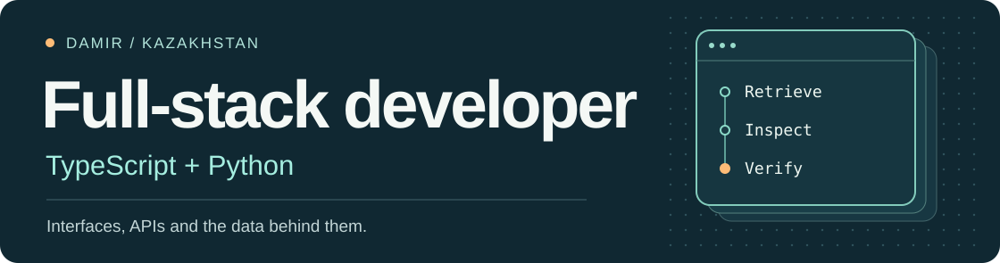
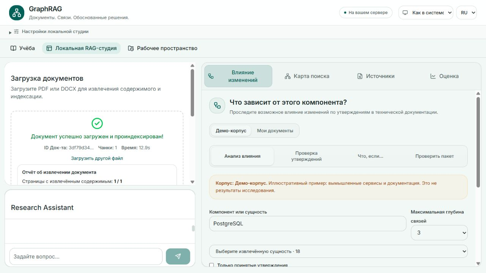
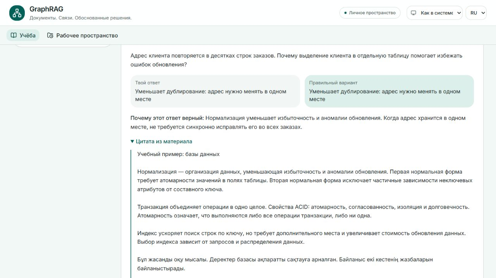

<h1>Damir · Full-stack developer</h1>

I build web applications in Kazakhstan with TypeScript and Python. My work spans document search, business software and decision tools.

**Open to full-stack roles with TypeScript and Python.** [Email me](mailto:foxfordkz@gmail.com) · [Browse the code walkthrough](ENGINEERING.md)

## Featured thesis · Multimodal Graph RAG

View the source excerpt

*Thesis interface, shown with demonstration materials.*

## Public code sample · Qadam Business

A seller in Taraz says a sale out loud in Kazakh or Russian. The app drafts the entry, the seller checks the customer and amount, and only then does it enter the ledger.

**What to look for:** the React screen handles review; the Python API decides whether the draft can be confirmed. If two confirmations arrive together, the tests check that only one sale is recorded.

[Open the app ↗](https://qadamx-taraz.pages.dev/) · [React screen](https://github.com/foxfordkz-cyber/qadamx-taraz/blob/main/apps/web/src/features/voice/Sale.tsx) · [FastAPI service](https://github.com/foxfordkz-cyber/qadamx-taraz/blob/main/apps/api/app/services/drafts.py) · [Concurrency tests](https://github.com/foxfordkz-cyber/qadamx-taraz/blob/main/apps/api/tests/test_drafts.py)

## More selected work

| Project | What to try | Look under the hood |
| --- | --- | --- |
| **[Green Pavlodar](https://github.com/foxfordkz-cyber/qadamxpavlodar)** | [Pick a plot](https://green-pavlodar-mock.pages.dev/), compare planting plans, then explore the 20-year forecast. | [Snapshot and recovery tests](https://github.com/foxfordkz-cyber/qadamxpavlodar/blob/codex/coordinator/apps/server/tests/outcomes.test.ts) show how a forecast survives later inspections and a server restart. |
| **[TeamTrustGate](https://github.com/foxfordkz-cyber/teamtrustgate)** | Follow a customer request from Telegram to a reviewed Jira ticket. | [Duplicate detection](https://github.com/foxfordkz-cyber/teamtrustgate/blob/main/deduplicator.py) uses a keyword fallback when the model is unavailable. |
| **[Qazaq Loc QA](https://github.com/foxfordkz-cyber/qazaq-loc-qa)** · team project | [See the editor](https://github.com/foxfordkz-cyber/qazaq-loc-qa/blob/codex/integration-kit/docs/images/review-overview.jpg) explain a flagged Russian-to-Kazakh translation. | [Team verification script](https://github.com/foxfordkz-cyber/qazaq-loc-qa/blob/codex/integration-kit/scripts/verify-team.mjs) ties the checks to a reproducible report. |

## Also built

| Project | What it is |
| --- | --- |
| **[First Year](https://github.com/foxfordkz-cyber/first-year-nyc)** | A persistent New York City sim of the first year of running your own business. [Play it ↗](https://ohhheaven-production.up.railway.app) |
| **[QARZHY](https://github.com/foxfordkz-cyber/qarzhilik)** | Financial literacy platform in Kazakh and Russian on Cloudflare Workers. [Open ↗](https://qarzhy.zerdeliportald.workers.dev) |
| **[Otbasy Budget](https://github.com/foxfordkz-cyber/qarzhy)** | Family budget app in Kazakh, plain JavaScript, works offline. [Try the demo ↗](https://foxfordkz-cyber.github.io/qarzhy/) |
| **[Zerdeli Saraptama](https://github.com/foxfordkz-cyber/zerdeli-saraptama)** | Curriculum review portal with voice comments and Supabase row-level security. |
| **[Otar](https://github.com/foxfordkz-cyber/otar-android)** | Android app for livestock farms, Kotlin. |

## Stack in practice

**Frontend** · TypeScript, React  
**Backend** · Python, FastAPI, PostgreSQL  
**Engineering interests** · Bilingual interfaces, API design, transaction safety and integration testing

If your team is building a product with a TypeScript frontend and a Python backend, [let’s talk](mailto:foxfordkz@gmail.com).
